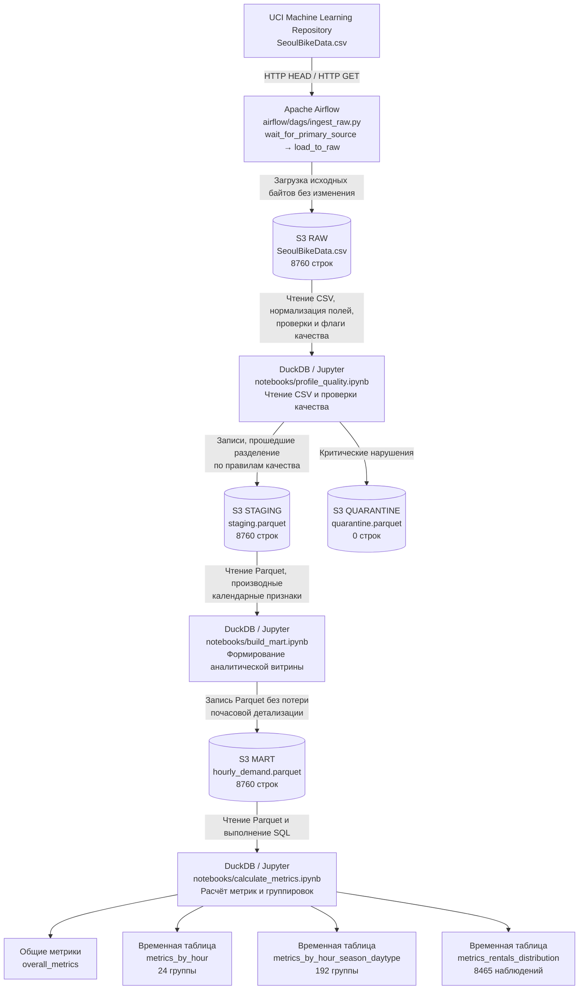

# Лабораторная работа № 6
## Документирование аналитического контура

**Проект:** Seoul Bike Sharing Demand
**Группа:** ИВТ-241

## 1. Контекст анализа

### 1.1. Аналитический вопрос

В рамках проекта рассматривается основной аналитический вопрос:

**В какие часы, сезоны и типы дней наблюдается наиболее высокий и низкий спрос на аренду велосипедов?**

Исследование направлено на выявление различий в количестве аренд велосипедов в зависимости от времени суток, сезона и типа календарного дня.

### 1.2. Выбранное значение метрики

Для прослеживания происхождения данных выбрано значение метрики среднего количества аренд за работающий час (`avg_rentals_operating`) для 18:00.

**Выбранное значение: 1554,02 аренды за работающий час.**

Параметры расчёта:

- Метрика: среднее количество аренд за работающий час.
- Часовой срез: 18:00.
- Период наблюдений: с 01.12.2017 по 30.11.2018.
- Количество всех наблюдений для данного часа: 365.
- Количество наблюдений, вошедших в расчёт среднего: 353.
- Условие включения: `functioning_day = TRUE`.
- Единица измерения: арендованные велосипеды за один час работы системы.

Значение рассчитывается с помощью функции `AVG(rented_bike_count)` при условии `functioning_day = TRUE`. В расчёт включаются только наблюдения, в которых система проката функционировала.

Общее количество аренд для часового среза 18:00 составляет 548568. Поскольку в неработающие часы количество аренд равно нулю, среднее рассчитывается по 353 работающим наблюдениям:

`548568 / 353 = 1554,02`.

Выбранное значение находится в основной группировке `metrics_by_hour` в ноутбуке `notebooks/calculate_metrics.ipynb`, в строке с `hour = 18`, в столбце `avg_rentals_operating`.

### 1.3. Исходные данные

Первоисточником является набор данных **Seoul Bike Sharing Demand**, опубликованный в UCI Machine Learning Repository.

Сведения об исходном наборе:

- Название файла: `SeoulBikeData.csv`.
- Репозиторий: UCI Machine Learning Repository.
- Идентификатор набора: 560.
- DOI: `10.24432/C5F62R`.
- Первоначальный источник данных: Seoul Open Data / Seoul Bike Sharing System.
- Формат: CSV.
- Период наблюдений: 01.12.2017–30.11.2018.
- Общее количество записей: 8760.

Каждая строка исходного набора представляет одно почасовое наблюдение системы аренды велосипедов.

В рамках проекта исходный CSV был загружен с помощью контура Airflow в локальное S3-совместимое хранилище SeaweedFS. Исходный объект размещён в слое `raw`:

`s3://raw/seoul_bike/ingested_on=2026-10-13/SeoulBikeData.csv`

Дата `2026-10-13` в пути обозначает логическую дату загрузки данных, а не период самих наблюдений.

Для дальнейшей обработки исходный CSV читается из S3, после чего данные проходят проверку качества и преобразование в слой `staging`, а затем используются для построения аналитической витрины `hourly_demand`.

## 2. Схема происхождения данных (Data Lineage)

### 2.1. Общая схема аналитического контура

Ниже представлена схема движения данных от исходного источника до результатов расчёта метрик в лабораторной работе № 5.



### 2.2. Описание переходов между слоями

**Источник → RAW**

Загрузка исходного набора выполняется с помощью Apache Airflow. В DAG `ingest_raw` сначала проверяется доступность HTTP-источника с помощью задачи `wait_for_primary_source`, затем задача `load_to_raw` загружает исходные байты файла и сохраняет их в S3-бакет `raw`.

Загрузка реализована в файле `airflow/dags/ingest_raw.py`. В качестве HTTP-источника используется путь к набору Seoul Bike Sharing в UCI Machine Learning Repository:

`ml/machine-learning-databases/00560/SeoulBikeData.csv`

Объект сохраняется без изменения содержимого по пути:

`s3://raw/seoul_bike/ingested_on=2026-10-13/SeoulBikeData.csv`

**RAW → STAGING и QUARANTINE**

Подготовка данных выполняется в Jupyter-ноутбуке `notebooks/profile_quality.ipynb` с использованием DuckDB.

Исходный CSV читается непосредственно из S3. При чтении используется кодировка `latin-1` и Hive-разметка пути.

Для каждой записи выполняются проверки качества:
- Уникальность сочетания даты и часа (`Date + Hour`).
- Наличие значения количества аренд.
- Допустимость часа наблюдения от 0 до 23.
- Отсутствие отрицательного количества аренд.
- Допустимость влажности от 0 до 100.
- Отсутствие аренд при неработающей системе.

Критические нарушения исключают запись из `staging` и направляют её в `quarantine`. Нарушение диапазона влажности обрабатывается отдельным флагом и само по себе не исключает запись из `staging`.

Результаты сохраняются в S3:
- `s3://staging/seoul_bike/source_ingested_on=2026-10-13/staging.parquet`
- `s3://staging/seoul_bike/source_ingested_on=2026-10-13/quarantine.parquet`

По результатам ЛР № 3 в `staging` сохранено 8760 строк, в `quarantine` — 0 строк. Баланс исходных и распределённых записей соблюдён.

**STAGING → MART**

Формирование аналитической витрины выполняется в ноутбуке `notebooks/build_mart.ipynb` с помощью DuckDB.

Входной файл `staging.parquet` читается из S3. На его основе создаётся широкая таблица `hourly_demand`.

При преобразовании:
- Сохраняются исходные почасовые наблюдения.
- Нормализованные поля переносятся в аналитическую витрину.
- Из даты вычисляются ISO-номер дня недели (`iso_weekday`), название дня (`day_of_week`) и тип дня (`day_type`).
- Сохраняется флаг качества влажности `quality_flag_humidity_out_of_range`.
- Сохраняется логическая дата загрузки `source_ingested_on`.

Витрина записывается по пути:

`s3://mart/seoul_bike/source_ingested_on=2026-10-13/hourly_demand.parquet`

Входной набор и готовая витрина содержат по 8760 строк. Исходная детализация не изменена, скрытая фильтрация и соединения со справочниками не выполнялись.

**MART → РЕЗУЛЬТАТЫ МЕТРИК**

Расчёт аналитических показателей выполняется в ноутбуке `notebooks/calculate_metrics.ipynb`.

В качестве источника используется сохранённый файл `hourly_demand.parquet`. SQL-запросы DuckDB формируют общий итог и три временные таблицы:

- `overall_metrics` — общие показатели набора данных, полученные в Python из результата SQL-запроса.
- `metrics_by_hour` — основная группировка по часам, содержит 24 группы.
- `metrics_by_hour_season_daytype` — уточняющая группировка по часам, сезонам и типам дней, содержит 192 группы.
- `metrics_rentals_distribution` — отдельные значения количества аренд для 8465 работающих часов.

Промежуточные результаты ЛР № 5 хранятся во временных объектах DuckDB и не записываются в отдельные файлы S3.

### 2.3. Расположение преобразований и проверок

| Этап | Файл проекта | Назначение |
|---|---|---|
| Загрузка исходных данных | `airflow/dags/ingest_raw.py` | Проверка HTTP-источника и загрузка CSV в RAW |
| Профилирование и качество | `notebooks/profile_quality.ipynb` | Чтение RAW, проверки, разделение STAGING и QUARANTINE |
| Отчёт о качестве | `docs/data_quality_report.md` | Описание правил качества и результатов ЛР № 3 |
| Сборка витрины | `notebooks/build_mart.ipynb` | Преобразование STAGING в MART и сохранение Parquet |
| Описание модели | `docs/mart.md` | Гранулярность, маппинг полей и ограничения витрины |
| Расчёт метрик | `notebooks/calculate_metrics.ipynb` | Общие показатели, группировки и числовая выборка |
| Описание метрик | `docs/metrics.md` | Определения показателей, результаты проверок и выводы |

В проекте используется составной ключ почасового наблюдения: `Date + Hour` в исходном наборе, `observation_date + hour` в аналитической витрине. Проверки подтвердили отсутствие пропусков и повторов по данному ключу.

При переходе из STAGING в MART отдельные таблицы измерений не создаются, соединения (`JOIN`) не выполняются. Все необходимые временные и календарные признаки формируются непосредственно из имеющихся полей.

### 2.4. Результаты проверок аналитического контура

По итогам предыдущих лабораторных работ получены следующие результаты:

- RAW содержит 8760 исходных почасовых записей.
- В STAGING сохранено 8760 записей, QUARANTINE содержит 0 записей.
- Баланс `raw = staging + quarantine` выполняется.
- Повторы ключа `Date + Hour` не обнаружены.
- Пропуски и критические нарушения проверенных правил качества не обнаружены.
- При записи аналитической витрины количество строк сохранилось: 8760.
- Повторы ключа `observation_date + hour` в MART не обнаружены.
- Проверки корректности переноса флагов качества пройдены.
- В основной группировке ЛР № 5 сумма долей всех часовых групп составляет 100 %.
- Количество подготовленных числовых наблюдений совпадает с числом работающих часов — 8465.

Таким образом, прослеживается полный маршрут данных от исходного CSV в RAW до временных результатов SQL-расчётов в DuckDB.

## 3. Маршрут данных для выбранного значения метрики

### 3.1. Источник выбранного значения

Выбранное значение среднего количества аренд за работающий час составляет 1554,02 для часового среза 18:00.

Результат находится в файле `notebooks/calculate_metrics.ipynb`:
- Ячейка 3 — расчёт общей статистики и формирование основной группировки.
- Временная таблица DuckDB: `metrics_by_hour`.
- Условие выбора строки: `hour = 18`.
- Столбец результата: `avg_rentals_operating`.

Основная группировка формируется SQL-запросом с использованием следующих выражений:

```sql
COUNT(*) AS observation_count,

COUNT(*) FILTER (
    WHERE functioning_day = TRUE
) AS operating_observation_count,

SUM(rented_bike_count) AS total_rentals,

AVG(rented_bike_count) FILTER (
    WHERE functioning_day = TRUE
) AS avg_rentals_operating
```

Группировка выполняется по полю `hour`.

Для выбранного значения получены следующие показатели:

| Показатель | Значение |
|---|---:|
| Час | 18 |
| Общее количество наблюдений | 365 |
| Работающих наблюдений | 353 |
| Общее количество аренд | 548568 |
| Среднее количество аренд за работающий час | 1554,02 |

Среднее рассчитывается только по наблюдениям, в которых `functioning_day = TRUE`. В знаменатель входят 353 наблюдения из 365.

Неработающие часы не участвуют в вычислении среднего. Согласно правилам качества ЛР № 3, для неработающей системы количество аренд равно нулю. Поэтому исключение таких часов из среднего не изменяет сумму аренд, но влияет на количество значений, по которым рассчитывается среднее.

Значение метрики получается делением количества аренд за работающие часы на число работающих наблюдений:

`548568 / 353 = 1554,02`.

### 3.2. Переход от метрики к аналитической витрине

Основная группировка читает данные из аналитической витрины `hourly_demand.parquet`, расположенной в S3:

`s3://mart/seoul_bike/source_ingested_on=2026-10-13/hourly_demand.parquet`

В ноутбуке `notebooks/calculate_metrics.ipynb` файл читается через DuckDB с использованием функции `read_parquet`.

Для расчёта выбранной метрики используются три основных поля:
- `hour` — определяет часовую группу, для которой рассчитывается среднее;
- `rented_bike_count` — содержит количество аренд и используется для вычисления среднего;
- `functioning_day` — определяет, включается ли наблюдение в расчёт среднего.

Дополнительно `observation_date` определяет дату почасового наблюдения и участвует в формировании составного ключа вместе с `hour`.

Витрина имеет почасовую гранулярность: одна строка представляет одно наблюдение за определённый час конкретной даты. Поэтому группировка по `hour` объединяет наблюдения одного и того же часа за весь период.

### 3.3. Словарь ключевых полей

| Поле в MART | Тип | Единица или смысл | Поле в RAW | Преобразование при подготовке | Роль в расчёте |
|---|---|---|---|---|---|
| `observation_date` | DATE | Дата наблюдения | `Date` | Преобразование даты в DATE и нормализация имени | Определяет период и идентифицирует почасовую запись |
| `hour` | BIGINT | Час суток, 0–23 | `Hour` | Перенос значения с нормализацией имени и типа | Группировка по часам, выбор группы 18 |
| `rented_bike_count` | BIGINT | Количество аренд за час | `Rented Bike Count` | Перенос значения с нормализацией имени и типа | Значение, по которому рассчитывается среднее |
| `functioning_day` | BOOLEAN | Признак работы системы | `Functioning Day` | Нормализация исходного статуса в TRUE/FALSE | Фильтрация наблюдений, участвующих в среднем |

В таблице показана связь между полями витрины и исходного CSV через подготовленный слой `staging`. Более полный маппинг полей всех столбцов витрины приведён в документе `docs/mart.md`, раздел 2 «Сопоставление полей».

### 3.4. Обратный маршрут до исходного датасета

Происхождение выбранного значения можно проследить в обратном направлении:

1. **Результат метрики.** В `notebooks/calculate_metrics.ipynb` основная группировка `metrics_by_hour` содержит среднее количество аренд для каждого часа. Для `hour = 18` получено значение 1554,02.

2. **SQL-расчёт.** Значение формируется выражением `AVG(rented_bike_count) FILTER (WHERE functioning_day = TRUE)` с группировкой по `hour`.

3. **Аналитическая витрина MART.** SQL-запрос читает `hourly_demand.parquet`, из которого берутся значения `hour`, `rented_bike_count` и `functioning_day`.

4. **Подготовка витрины.** Файл `notebooks/build_mart.ipynb` формирует `hourly_demand` из подготовленных данных STAGING. Почасовая детализация сохраняется, значения количества аренд и признак работы системы переносятся в витрину.

5. **Подготовка данных STAGING.** Файл `notebooks/profile_quality.ipynb` читает исходный CSV из RAW, выполняет преобразование полей, нормализует названия столбцов и проверяет качество данных. В частности, проверяется наличие количества аренд и соответствие количества аренд признаку работы системы.

6. **Исходный датасет RAW.** Первоисточником является файл `SeoulBikeData.csv`, расположенный по пути:

`s3://raw/seoul_bike/ingested_on=2026-10-13/SeoulBikeData.csv`.

В исходном файле находятся поля `Date`, `Hour`, `Rented Bike Count` и `Functioning Day`, из которых в дальнейшем формируются используемые для расчёта поля аналитической витрины.

Таким образом, значение 1554,02 связано с конкретными почасовыми записями исходного датасета через последовательные этапы загрузки, проверки качества, подготовки витрины и расчёта SQL-метрик.

## 4. Влияние изменения формулы среднего количества аренд

### 4.1. Описание возможного изменения

В качестве возможного изменения рассматривается изменение формулы расчёта среднего количества аренд за час.

В текущей реализации среднее рассчитывается только по наблюдениям, в которых система проката работала:

`AVG(rented_bike_count) FILTER (WHERE functioning_day = TRUE)`.

Предположим, что в будущем аналитическое требование изменится и среднее потребуется рассчитывать по всем почасовым наблюдениям независимо от того, работала ли система.

В таком случае фильтр `functioning_day = TRUE` будет удалён из выражения расчёта среднего.

### 4.2. Какие данные и результаты будут затронуты

Изменение возникнет на этапе расчёта метрик в ноутбуке `notebooks/calculate_metrics.ipynb`.

В первую очередь оно затронет следующие результаты:

- `overall_metrics` — изменится общее среднее количество аренд.
- `metrics_by_hour` — изменятся значения среднего количества аренд для часовых групп.
- `metrics_by_hour_season_daytype` — изменятся значения среднего в группах по часам, сезонам и типам дней.
- Аналитические выводы и будущие визуализации в рамках ЛР № 7 — будут основываться на изменённых значениях среднего.

Таблица `metrics_rentals_distribution` при сохранении текущего условия отбора `functioning_day = TRUE` не изменится, поскольку её формирование использует отдельный запрос с собственным фильтром.

Количество строк, суммарное количество аренд и размеры групп не изменятся, поскольку изменение касается только условия включения значений в расчёт среднего.

Исходные данные в RAW, подготовленные данные в STAGING и аналитическая витрина MART также останутся без изменений. Изменение не затрагивает преобразования данных и правила качества предыдущих лабораторных работ.

При альтернативной формуле количество всех наблюдений останется прежним, а `operating_observation_count` по-прежнему будет показывать 353 работающих наблюдения. Просто эти 353 значения уже не будут знаменателем нового среднего — им станут все 365 наблюдений.

### 4.3. Влияние на выбранное значение метрики

Для часового среза 18:00 исходные показатели следующие:

- Количество всех наблюдений: 365.
- Количество работающих наблюдений: 353.
- Общее количество аренд: 548568.
- Количество аренд в неработающие часы: 0.

При текущей формуле:

`548568 / 353 = 1554,02`.

Если учитывать все 365 наблюдений, результат составит:

`548568 / 365 = 1502,93`.

Таким образом, выбранное значение метрики уменьшится с 1554,02 до 1502,93 аренды за час.

Причина изменения заключается в том, что при новой формуле в знаменатель дополнительно включаются 12 наблюдений, соответствующих неработающим часам. Для этих наблюдений количество аренд равно нулю.

### 4.4. Общий вывод о влиянии изменения

Изменение формулы среднего количества аренд затронет результаты расчёта общей метрики и обеих группировок ЛР № 5, а также последующий анализ в ЛР № 7.

При этом исходные данные, количество строк, суммарное количество аренд и структура аналитической витрины останутся прежними.

Рассмотренное изменение демонстрирует, что даже при неизменности исходных данных изменение одного условия SQL-запроса может повлиять на аналитические показатели и итоговые выводы.

Описанный сценарий является возможным изменением методики расчёта. В текущей реализации сохраняется первоначальное правило: среднее количество аренд рассчитывается только за часы работы системы.
